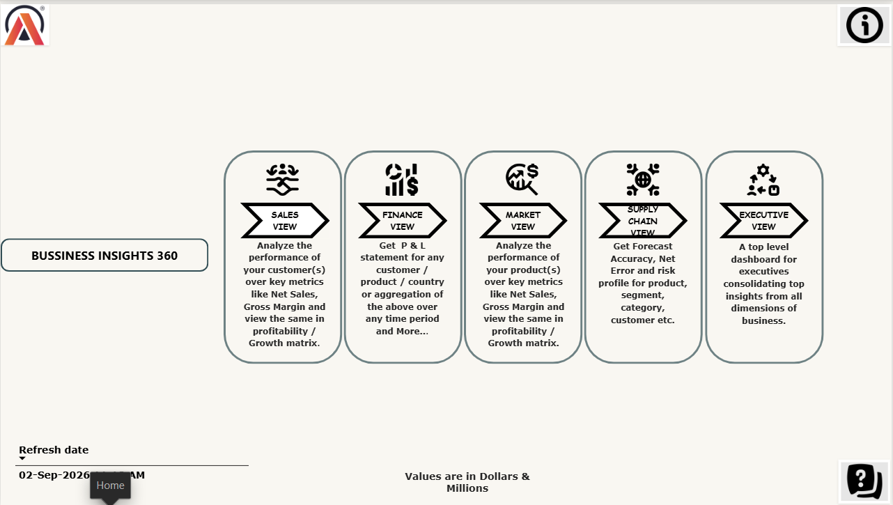
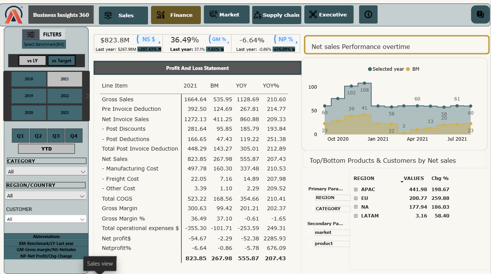

# Business-Intelligence 360 - Power Bi project

## 🎈 Project Overview
Atliq hardware is been growing rapidly in recent years.so to stay ahead of competition company as decided to take data  driven decision.

This project was built to give a edge over the competitors and providing with insights on **Sales,Finance.Market and supplyChain**.This project is part of **codebasics Power Bi course Business intelligence 360**.

The objective is to bring all scattered data into make a precise and readable data to provide valuable insights to take data driven decision.

## 🎈 About Commpany
AtliQ Hardware is consumer electronics & computer hardware company and sells its products on 4 ways:
- 1.**Retailers / Brick & Mortar Stores**
- 2.**Direct-to-Consumer**
- 3.**Distributor Networks**
- 4.**E-Commerce Platforms**

## 🎈 Core Problems

- **Excel Dependency**: The company relied heavily on manual, static Excel spreadsheets across regional branches.
- **Lack of Visibility**: Regional sales managers were presenting overly optimistic reports during verbal calls, while actual net sales and margins were declining.
- **Unplanned Losses in New Markets**: The company expanded aggressively into markets like Latin America (LATAM) and suffered major net losses due to unexpected                                           post-invoice deductions, high customer discounts, and poor supply chain forecasting.

## 🎈 Tools
- **EXCEL**: Review and understand data.
- **SQL**: Data extraction.
- **POWERBi**: Build dashboard and Report.
- **DAX STUDIO**: Optimization performance.
- **POWERBi SERVICE**: Share and refresh.

## 🎈 Technical Implementation
- Data Modelling -Created *Snowflake Model* Connecting fact and dimenesion tables.
- Advanced Dax- To create advance Dax measures.
- Date Table-Created Using M_language.
- KPI(Key performing indicators)
- Conditional formatting
- Dynamic filters and Titles.
- Page Navigation and bookmarks to switch between visuals and Parameters.
- Publishing Report in PowerBi service.

## 🎪 Dashboard

### 🌍 Landing Page
- Central hub to access all business dimensions (sales,finanace,market,supplychain and executive view) and Navigate(page navigation).
  

### 🤝 Sales view
**Key Observation**- While top e-commerce and retail channels (Amazon, Atliq direct channels) drive the vast majority of volume, heavy promotional and post-invoice deductions are eroding gross margin percentage, highlighting the need to optimize partner discount structures.

### 💲 Finance view
**Key Observation**-The business is prioritizing aggressive acquisition of market at the expense of profitability .Immediate corrective action requires capping promotional post-discounts and auditing operational expenses  to prevent further net operating losses.

### 💹 Market view
**Key Observation**-Even though the products generated  gross profit, the company spent lot on logistics, marketing, warehousing, and administrative expenses. To fix the business, management does not need to redesign the products—they need to cut shipping inefficiencies, streamline warehouse operations, and control general operating expenses.

### 🛒 Supply chain view
**Key Observation**- Relying on net error masks operational failure; supply chain teams must track and reduce ABS error (9.8M) to prevent simultaneous stockouts and overstocking.Divert excess production allocations away from slow-moving retail accounts (e.g., Boulanger, Euronics) and toward high-velocity fulfillment channels (Amazon, Atliq direct stores) to capture lost demand without inflating overall warehouse costs.

### 👥 Executive view
**Key Observation**- Despite increase Net Sales and  market share, AtliQ’s profitability (Net Profit margin)collapsed . This net loss was driven by massive operational deficits in its two largest revenue markets—India  and North America compounded by operational imbalances: Excess Inventory in India and severe Out-of-Stock bottlenecks in NA

## LIVE AND INTERACTIVE DASHBOARD

- 🔗**LIVE**-https://app.powerbi.com/groups/me/reports/8c67c91e-6a67-4672-b535-ea2a1d6e325e/edd9586f09dcdad3b5ee?experience=power-bi

-

 

